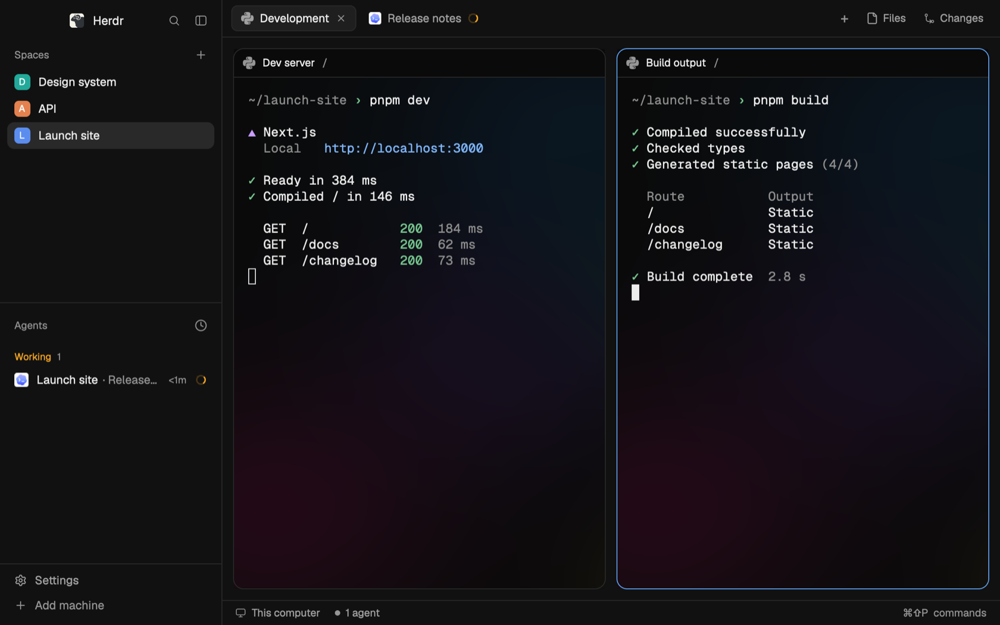

# Vercel for Herdr

Vercel is a dark workspace with Geist typography, thin dividers, and blue focus borders. Spaces and agents stay on the left, with terminals in the center and Files and Changes available on the right. You can put a local image behind the text in every terminal pane.

## What you see

- A 248 px sidebar on a `#111111` canvas, with a 46 px title area, the Spaces and Agents lists, and a 69 px footer for Settings and machine controls.
- A 42 px tab bar with a new-tab menu and Files and Changes buttons. The right panel starts at 368 px when opened and can be resized.
- Terminal cards with 12 px corners, 12 px gaps, 16 px inner padding, and a 32 px header. They use `#0a0a0a` for the background, `#ededed` for the text, and a 1 px `#60a6fa` border for the focused pane. Terminal text is 14 px Geist Mono. The rest of the interface uses Geist.
- A 28 px status bar with the active machine, branch when available, agent count, and a command-palette shortcut.

## How it behaves

- Select a space or tab to show its terminals. The sidebar can collapse, and Files and Changes share the right panel. Hover a terminal's header to split, zoom, or close that pane. Drag the split boundary to resize panes.
- Working agents have amber spinners. Blocked agents use red and show a Needs you label in the agent list and pane header. Newly finished agents use blue dots. Idle agents use muted gray without a spinner.
- Install the optional [Terminal background mod](https://github.com/gridness/herdr-mods/tree/main/terminal-background) to apply the sort of image shown in the preview.

## Built from

- `layouts/vercel.json` starts with Herdr 0.1.18's `main` layout. Keep `workspace-chrome` for the sidebar title and footer, `spaces` and `agents` for the sidebar lists, `tabs` for the tab bar, `pane` for pane headers, `files` and `changes` for the right panel, and `workspace-status` for the status bar. The workspace center uses the `main` block with `content.tab: "active"`.
- `themes/vercel-geist.json` supplies the terminal's 16 ANSI colors and Herdr's UI colors. Copy it into Herdr's `themes/` folder and the layout into `layouts/`. Set the root theme to `vercel-geist` for both system appearances.

## Watch out

- An image is optional and the default is solid. The preview uses a demo image. Terminal apps that paint their own background can cover the image in those areas.

## Done when

- Switching to Vercel shows the dark palette, Geist fonts, and active-pane border in both system appearances.
- Tabs, split panes, Files, and Changes work through the standard Herdr controls.
